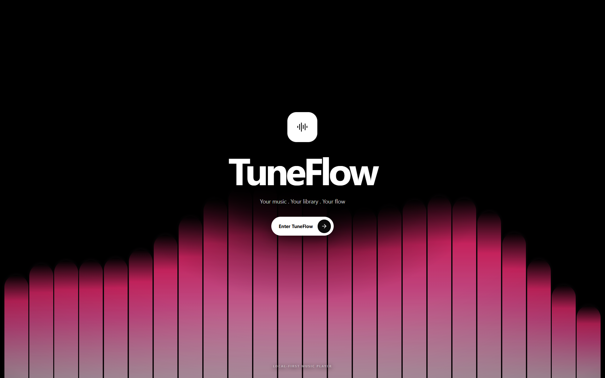
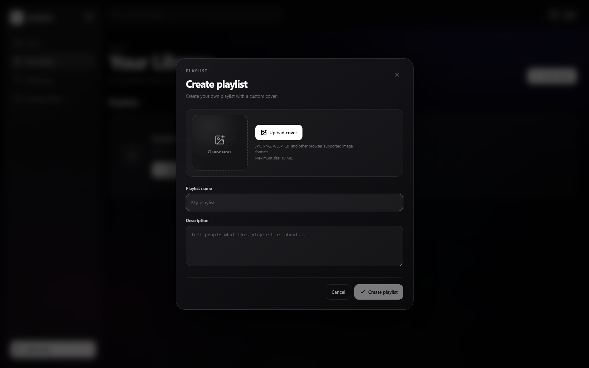

# TuneFlow

### Your sound. Your flow.

<p align="center">
  <strong>A personal music library and browser-based music player.</strong>
</p>

<p align="center">
  Manage your music. Organize your playlists. Listen your way.
</p>

---

## About TuneFlow

TuneFlow is a browser-based personal music library and player built to make
managing, organizing, and listening to locally uploaded music simple, clean,
and enjoyable.

TuneFlow provides a local music experience with audio playback, music
organization, playlists, search, metadata detection, album artwork, liked
songs, and recently played tracks.

The project was created as an independent software project with a focus on
a clean user interface, local music management, and a straightforward
listening experience.

---

## Preview

### Home



### Your Library


### Music Player


### Upload & Metadata


### Playlist




---

## Features

### Music Library

- Upload local music files
- Play music directly in the browser
- Persistent local music library
- Search music by title, artist, or album
- Like and manage tracks
- Recently played music
- Delete individual tracks
- Delete all uploaded music
- Local library persistence

### Metadata & Album Artwork

- Automatic music metadata detection
- Album and track information extraction
- Embedded album artwork detection
- Online album artwork resolution
- Artwork fallback handling
- Multilingual music metadata support
- Unicode-compatible metadata handling
- Support for music from different languages and writing systems

### Playlists

- Create playlists
- Edit playlists
- Delete playlists
- Add tracks to playlists
- Remove tracks from playlists
- Custom playlist artwork

### Audio Player

- Play and pause
- Previous and next track controls
- Track seeking
- Playback progress
- Volume control
- Mute and unmute
- Shuffle
- Repeat
- Current track artwork

### User Experience

- Clean responsive interface
- Drag-and-drop music uploading
- Upload progress indicator
- Intro screen
- Collapsible sidebar
- Search interface
- Custom TuneFlow branding
- Accessible controls
- Keyboard-friendly controls
- Reduced-motion support for supported animations

---

## Supported Audio Formats

TuneFlow supports commonly used audio formats including:

- MP3
- WAV
- OGG
- WebM
- MP4 / M4A
- AAC
- FLAC

Actual playback support can vary depending on the browser and operating
system.

---

## Metadata & Album Artwork

TuneFlow attempts to extract useful information from uploaded music files
and resolve appropriate album artwork.

The artwork system uses a fallback approach:

1. Embedded artwork from the uploaded audio file
2. Online music artwork sources
3. Regional music databases and storefronts
4. TuneFlow fallback artwork when matching artwork cannot be found

TuneFlow is designed to preserve Unicode metadata so music information can
be displayed across different languages and writing systems.

Artwork availability ultimately depends on the metadata contained in the
uploaded file and the availability of a matching recording in the available
artwork sources.

Some obscure, unreleased, incorrectly tagged, or region-specific recordings
may not have matching artwork.

---

## Privacy & Local Storage

TuneFlow is designed around a local music library experience.

Uploaded music and library information are handled on the client side and
stored using browser-based local storage technologies used by the
application.

TuneFlow does not require a traditional user account to maintain a local
music library.

Because the library is stored locally in the browser, clearing browser site
data or removing the application's stored data may remove locally stored
library information.

Users should keep their original music files separately if they need a
permanent backup.

---

## Technology Stack

TuneFlow is built with:

- React
- JavaScript
- Vite
- HTML
- CSS
- Browser APIs
- Client-side storage
- Lucide React

---

## Project Structure

```text
TuneFlow/
│
├── public/
│   └── Public assets
│
├── src/
│   ├── components/
│   │   ├── Audio player components
│   │   ├── Library components
│   │   ├── Playlist components
│   │   ├── Upload components
│   │   └── Interface components
│   │
│   ├── context/
│   │   ├── Library context
│   │   └── Player context
│   │
│   ├── hooks/
│   │   └── Reusable React hooks
│   │
│   ├── utils/
│   │   ├── Audio utilities
│   │   ├── Metadata processing
│   │   └── Formatting utilities
│   │
│   ├── App.jsx
│   ├── main.jsx
│   └── index.css
│
├── screenshots/
│   ├── home.png
│   ├── library.png
│   ├── player.png
│   └── upload.png
│
├── index.html
├── package.json
├── package-lock.json
├── README.md
├── LICENSE
└── .gitignore